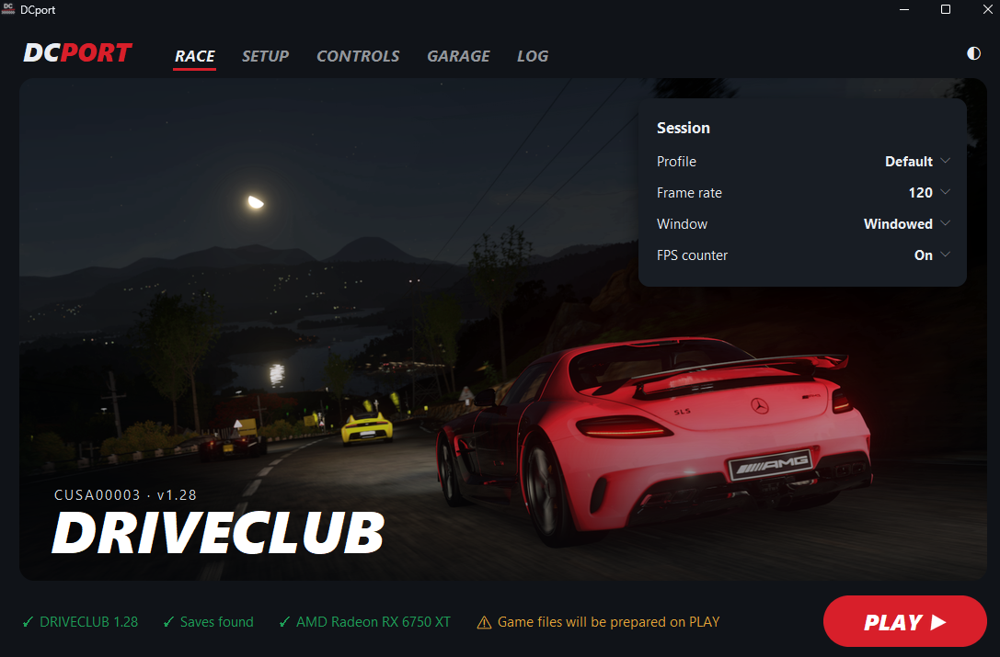
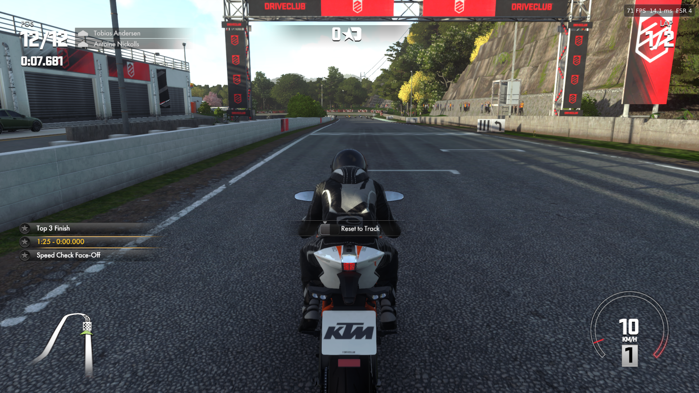

# Driveclub Native

[](https://youtube.com/@blacklineinteractive)


A native port of **Driveclub** (PS4, CUSA00003) to **macOS** and **Windows**.

| Platform | Game version | Renderer | Where | Maintainer |
| --- | --- | --- | --- | --- |
| macOS (Intel) | v1.05 | Metal 3 | this repository's `src/` | [BlackLineInteractive](https://github.com/BlackLineInteractive) |
| Windows 10/11 | v1.28 | Vulkan (shadPS4's renderer), FSR 3.1 / FSR 4 / FSR 4.1.1, frame generation | [`windows/`](windows/README.md) — ready-to-play builds on the [Windows releases](https://github.com/qnfn/Driveclub-Port/releases) | [qnfn](https://github.com/qnfn) |

**Windows highlight:** DCport 0.3.0 can build AMD's **FSR 4.1.1** for Vulkan from your own DirectX 12 DLL, on your PC, in one click (about two minutes), and run it with FSR 3 frame generation. See [`windows/README.md`](windows/README.md#-new-in-030-fsr-411-built-on-your-own-pc-in-one-click).

The sections below describe the macOS backend; the Windows backend (DCport) runs on a native PS4 runtime based on [Supermedo/bloodborne_pc](https://github.com/Supermedo/bloodborne_pc) and is documented in [`windows/README.md`](windows/README.md).

**Windows (DCport):**





This is not a general-purpose emulator. PS4 code is x86-64, so on Intel Macs it executes directly without CPU recompilation. We only replace what is console-specific: Sony system libraries (HLE) and the AMD Liverpool GPU (GCN) - with a custom Metal renderer tailored specifically for this single game.

## Repository layout

| Path | Backend | Platform | What it is |
| --- | --- | --- | --- |
| `src/` | Metal (`src/gpu/metal`) | macOS | Our native runtime: ELF loader, HLE libraries, PM4 command processor, GCN → MSL |
| `windows/` | Vulkan (DCport) | Windows | Separate native runtime (bloodborne_pc + `runtime/driveclub-runtime.patch`), launcher, community patches |

`src/` and `windows/` are independent: each has its own runtime and build, and changes to one do not affect the other. Fixes found on one side are worth checking on the other (both translate the same GCN/PM4 stream).

## Architecture

```
eboot.bin (x86-64, natively executed)
   │  imports of 922 functions from 57 libraries
   ▼
Sony HLE libraries ── libkernel, libc, Pad, AudioOut, VideoOut, Network/PSN -> stubs
   │  sceGnmSubmitCommandBuffers / sceGnmDingDong
   ▼
GPU frontend ── PM4 packet parsing, register state, GCN shaders -> IR
   │  src/gpu/renderer.h
   └──► Metal 3 (macOS) - src/gpu/metal, IR -> MSL directly
```

Gnm/Gnmx are embedded directly into eboot: the game writes PM4 packets into the command buffer itself and passes only the finished buffer to the driver (`sceGnmDraw*` are not imported). Therefore, the GPU layer operates at the PM4 + GCN shader level.

### Performance Principles

- Shader IR -> MSL directly, without SPIR-V/SPIRV-Cross; disk cache for compiled pipelines.
- Argument buffers Tier 2 (bindless) - minimal resource binding overhead per draw.
- Up to 3 frames in flight; CPU waits for GPU only when running 3 frames ahead.
- On discrete AMD GPUs, memory is not unified: dirty page tracking and uploading modified ranges only.
- Explicit discrete GPU selection on dual-GPU MacBooks (`DC_GPU=<partial_name>` override).

## Requirements

- Intel Mac (x86_64), Metal 3-capable GPU (tested: AMD Radeon Pro 5500M), or an Apple Silicon Mac
  running the x86_64 build under Rosetta 2 (see [Apple Silicon](#apple-silicon))
- Xcode, CMake >= 3.24, Ninja, SDL3 (`brew install cmake ninja sdl3`)
- Your own copy of the game as a decrypted dump (fSELF/fPKG)

**Windows**

- Windows 10/11 64-bit, a CPU with AVX, a Vulkan 1.3 GPU (FSR 4 needs a recent AMD or NVIDIA GPU)
- Your own decrypted dump of Driveclub v1.28; no Python or build tools needed for the release builds

## Build

**macOS**

```bash
cmake -S . -B build -G Ninja
cmake --build build
./build/driveclub
```

### Apple Silicon

PS4 code is x86-64, so the process has to be x86_64 even on an M-series Mac; Rosetta 2 then
translates the game's code (and ours) to arm64. Nothing about the build is arm64.

1. Install the Intel Homebrew next to the native one, and the dependencies through it:

   ```bash
   arch -x86_64 /bin/bash -c "$(curl -fsSL https://raw.githubusercontent.com/Homebrew/install/HEAD/install.sh)"
   arch -x86_64 /usr/local/bin/brew install cmake ninja sdl3
   ```

2. Configure and build as x86_64 (CMake detects Apple Silicon, uses `/usr/local`, and defaults
   to `-march=x86-64-v2`, the baseline Rosetta guarantees):

   ```bash
   arch -x86_64 /usr/local/bin/cmake -S . -B build -G Ninja -DCMAKE_OSX_ARCHITECTURES=x86_64
   arch -x86_64 /usr/local/bin/cmake --build build
   ./build/driveclub <game_dir>
   ```

   Pass `-DDC_HOST_MARCH=x86-64-v3` to allow AVX2 on macOS 15 or later.

What differs from an Intel Mac:

- **Guest TLS.** Rosetta has no LDT (`i386_set_ldt`), so FS cannot be pointed at the TCB. At load
  time `src/core/fs_patcher.cpp` rewrites the guest's `fs:` accesses to go through GS, which
  addresses the pthread TSD array: `fs:[0]` and `fs:[0x28]` (TCB pointer, stack canary) keep their
  length and just read a TSD slot; other offsets jump to a small trampoline. The load log prints
  `fs patcher: N in place, N via trampoline, N unsupported`; anything unsupported is warned about.
  `DC_TLS=ldt|patch` forces a mode (native Intel keeps the LDT path by default).
- **TSC.** Rosetta emulates `rdtsc`, so the TSC frequency is measured at startup instead of read
  from `machdep.tsc.frequency`.
- **GPU memory.** Unified memory is used as such: textures are `Shared`, not `Managed`.

Rosetta 2 reserves the 64-448 GB address range (`[0xFC0000000, 0x7000000000)`, no access) in
every translated process, so the guest "user" range that starts at 64 GB cannot be mapped there:
an executable that asks for it is killed by the kernel at exec, before `main`. On Apple Silicon
`DC_GUEST_USER_RANGE` therefore defaults to OFF and the guest gets the 0-63 GB system areas only,
where default allocations are placed (from 8 GB). If the game requests fixed addresses at 64 GB
or above, the loader reports `guest map ... is outside the reserved ranges` with the address.
Check what the binary asks for with `otool -l build/driveclub | grep -A3 "segname GUEST"`.

### Vulkan renderer

`src/gpu/vulkan` puts shadPS4's Vulkan renderer (`video_core` + `shader_recompiler`,
vendored in `third_party/shadps4`) behind the same `Gpu::Renderer` interface; our PM4
command processor stays the front end. It is built when a Vulkan loader is found
(`-DDC_ENABLE_VULKAN=ON/OFF`) and selected at run time with `DC_RENDERER=vulkan`.

- Extra build dependencies: Vulkan loader + headers and `glslang` (`brew install vulkan-loader
  vulkan-headers glslang molten-vk`). The other libraries (sirit, VMA, Boost headers, fmt,
  magic_enum, robin-map, xbyak, Zydis, half, xxHash, miniz, Tracy headers) are taken from
  system packages, from a shadPS4 checkout's `externals` (`DC_SHADPS4_EXTERNALS`, default
  `./shadps4/externals`) or fetched by CMake.
- The GPU needs sparse buffers (`sparseResidencyBuffer`) and `robustness2`: desktop AMD,
  NVIDIA and Intel drivers on Windows/Linux have them; MoltenVK on Intel Macs does not, so
  there the renderer stops with an error after creating the device.
- Windows/Linux builds still need the core (`src/core`: loader, memory, signals, TLS) ported;
  it is macOS-only for now.
- Options: `DC_VK_GPU=<index>`, `DC_VK_VALIDATION=1`, `DC_VK_MARKERS=1`, `DC_VK_DUMP_SHADERS=1`,
  `DC_VK_READBACKS=0|1|2`, `DC_VK_LOG=debug`.

## Game Files

Game files **are not included** in the repository and must never be committed (see `.gitignore`).
Unpacking PKG:

```bash
tools/extract.sh <path_to_pkg> extracted
```

eboot analysis (imports by library):

```bash
tools/elfinfo.py extracted/Image0/eboot.bin
tools/elfinfo.py extracted/Image0/eboot.bin --lib libSceGnmDriver
```

## Legal Disclaimer

- **No Proprietary Game Files**: This project does not distribute, host, or link to any copyrighted material, proprietary game assets, PKG dumps, ROMs, executables (`eboot.bin`), libraries (`.prx`), engine archives (`.dat`), audio, or textures. Users must provide their own legitimately acquired copy of Driveclub (CUSA00003).
- **Intellectual Property**: Driveclub is a registered trademark of Sony Interactive Entertainment LLC. All trademarks, service marks, game titles, and copyrighted assets belong to Sony Interactive Entertainment and Evolution Studios.
- **Educational and Preservation Purpose**: This repository is an independent reverse-engineering project conducted strictly for interoperability, software preservation, and educational purposes. It is not affiliated with, endorsed by, or sponsored by Sony Interactive Entertainment, Evolution Studios, or any associated entities.

## License

This project is licensed under the **GNU General Public License v2.0 or later (GPL-2.0-or-later)** - see the [LICENSE](LICENSE) file for details.

## Acknowledgments

- [shadPS4](https://github.com/shadps4-emu/shadPS4) - PS4 emulator, the primary source of knowledge on ELF loading, HLE libraries, PM4, and GCN shader recompilation. Its Vulkan renderer is the reference for GCN/PM4 semantics in the Metal backend, and the renderer of the Windows backend.
- [OpenGNM](https://ps4-opengnm.github.io/opengnm/) - documentation on PS4 Gnm and GCN shaders.
- Windows backend: deadinside28 and Supermedo (native PS4 runtime), FireBurn (FSR-Vulkan, FSR 4 assets), akitaonrails and the patch authors; see [`windows/README.md`](windows/README.md).
